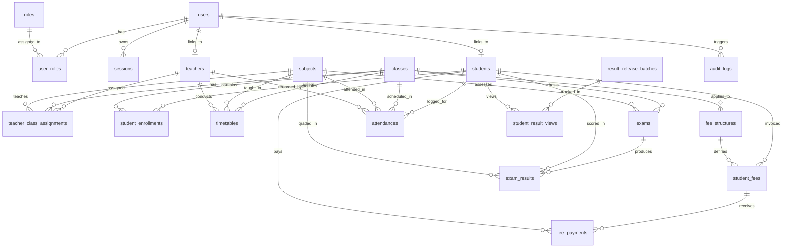

# Entity Relationship Diagram (ERD)

Database: `hawlwadaag_school_db`  
Engine: PostgreSQL 18.4

---

## Relationship Overview & Foreign Key Integrity

1. **User Identity & Roles**:
   - `users` (1) ── (N) `user_roles` (N) ── (1) `roles`
   - Every Teacher and Student can optionally possess a linked `User` login account (`users.id`).

2. **Faculty Assignments**:
   - `teachers` (1) ── (N) `teacher_class_assignments` (N) ── (1) `classes`
   - `teacher_class_assignments` (N) ── (1) `subjects`
   - Composite unique constraint `(teacher_id, class_id, subject_id, academic_year)` prevents duplicate assignment of the same subject load.

3. **Student Enrollments**:
   - `students` (1) ── (N) `student_enrollments` (N) ── (1) `classes`
   - Allows historical tracking of students transitioning across grades (e.g. Grade 7 in 2024-2025 -> Grade 8 in 2025-2026).

4. **Timetables**:
   - Relates `classes`, `subjects`, and `teachers` by `(day_of_week, start_time, end_time, academic_year)`.
   - Backend validation ensures no teacher, class, or room collisions exist simultaneously.

5. **Financial Ledger**:
   - `fee_structures` define base amounts.
   - `student_fees` tracks `amount_due`, `amount_paid`, and calculated `balance`.
   - `fee_payments` records immutable receipts linked to both invoice and student.

6. **Examinations & Grading**:
   - `exams` are scheduled per class & subject.
   - `exam_results` stores individual student marks, percentages, grades, and remarks with unique constraint `(student_id, exam_id, subject_id)`.

7. **Student Attendance Tracking**:
   - `attendances` records each lecture period's attendance status (`PRESENT`, `ABSENT`, `EXCUSED`, `LATE`).
   - Composite unique constraint `(student_id, date, subject_id, period)` guarantees idempotency and prevents duplicate entries.

8. **Result Release & Student View Auditing**:
   - `result_release_batches` audits class-wide result publication by Admin.
   - `student_result_views` tracks when a student first and last views their released official transcript.
